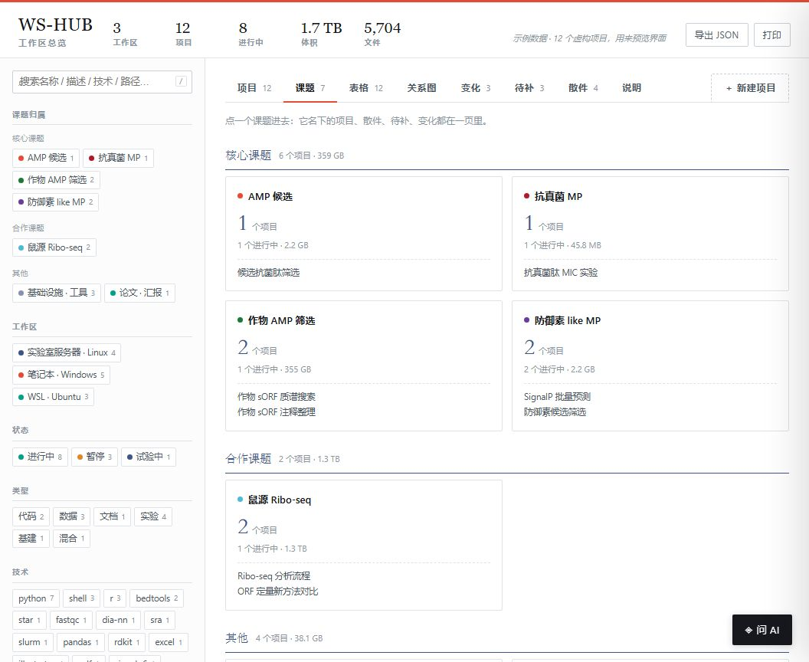

# Bio Workspace Hub · 生信项目流程管理工具

**把散在几台机器上的生信项目、数据、流程，盘成一张能搜、能看、能改、能问答的索引看板。**

实验室里常见的样子：Ribo-seq 的 bam 在服务器、质谱搜索在另一台工作站、候选肽的表格在笔记本、论文图又在自己桌面。
半年后你只记得「好像跑过」，但说不清哪个脚本是最终版、哪批数据还能删、这个课题到底做到哪一步。

Bio Workspace Hub 补的就是这层**结构化记忆**：AI 只读地扫一遍每台机器，产出一份 JSON；汇总成一个**离线可用的单文件看板**。
它不搬数据，只回答四个问题：**有什么、在哪、干什么用、做到哪一步。**

```
 Windows / WSL / Linux                 中心仓库                      你看到的
┌──────────────┐   latest.json   ┌──────────────┐   build.mjs   ┌──────────────────┐
│ 笔记本        │ ─────────────► │  workspace    │ ────────────► │  dashboard.html  │
│ 计算服务器     │                │   hub (git)   │               │  课题 / 搜索 / 图  │
│ WSL / 旧台式   │ ◄───────────── │               │ ◄──────────── │  可编辑 / 可问答  │
└──────────────┘    采集 prompt    └──────────────┘   写回 + 重建   └──────────────────┘
```

---

## English TL;DR

**Bio Workspace Hub is a multi-machine workspace index for bioinformatics projects.**

An AI agent scans each workspace read-only (Ribo-seq runs, MS searches, scripts, references) and writes one
`latest.json` per machine. `tools/build.mjs` merges them into a **single-file, offline dashboard** with topic
grouping, full-text search, a relationship graph, a change timeline, inline editing, and an AI Q&A panel.
No database, no server needed to view. Designed for research groups whose work sits on a laptop, a compute
server, and a WSL box at the same time.

---

## 为什么生信特别需要它

生信项目的「状态」不在一处：

- **三种机器**：笔记本写脚本和画图、服务器跑比对和定量、WSL 里装工具
- **三种数据**：原始数据（几百 GB 的 raw/fastq）、中间结果（bam、parquet）、结果表（csv/tsv）
- **三种版本**：`rank_v1.py` → `rank_v2.py` → `rank_v3.py`，只有跑通的那版活在你脑子里
- **三种口径**：这个物种用 DIA-NN、那个物种用 FragPipe，参数只写在某次对话里

文件管理器能告诉你**有什么文件**，但不会告诉你**为什么有、能不能删、下一步做什么**。
这个工具把「项目」当成一等公民：一个项目 = 一个目录 + 它的来龙去脉 + 它的数据 + 它的坑。

## 它长什么样

```bash
node tools/build.mjs --demo     # 用内置示例数据生成 dashboard-demo.html
```



> 学术论文风的界面：白底、细线、衬线标题。首页按「核心课题 / 合作课题 / 其他」分组，每个课题一张卡片，
> 点进去是这个课题下的全部项目、相关散件、待补和变化。

## 核心功能

### 一、AI 采集：只读、可追溯

把 `prompts/01-collect.md` 贴给每台机器上的 OpenCode，它会：

- 判定什么算一个「项目」：有 `.git`、README、入口脚本的目录；同主题的版本文件合成一个
- 读 README、`git log`、依赖清单、数据目录，写出**来龙去脉**：为什么建、从哪来、做到哪、卡在哪
- 每条结论都带**证据**（文件路径 + 行号、commit、目录结构），查不到就写「未确认」
- 只写两个文件：`workspaces/<机器>/latest.json` 和 `history/<时间>.json`

不修改代码、不运行项目、不安装依赖。

### 二、多机器合并，天然无冲突

每台机器只写自己的目录：

| 方式 | 适合 |
|---|---|
| **git** | 最稳，自带历史；每台机器 `pull → 采集 → push` |
| **网盘同步** | 不想配 git：同步整个 hub 文件夹（Win↔Win 最省事） |
| **scp / rsync** | 服务器不方便联网时，从主机器主动拉 |

跨机器关系也能连：服务器上的流程可以 `depends_on` 笔记本上的脚本，看板的关系图会画出来。

### 三、在界面上直接改

`node tools/serve.mjs` 启动一个**只监听 127.0.0.1** 的本地服务：

- 状态是下拉框，**选中即保存**（写回 `latest.json` 并自动重建）
- 详情页「✎ 编辑」可改名称、一句话、来龙去脉、状态、课题、类型、标签、下一步、风险
- **新建 / 删除项目**：手工补一条还没采集到的，或清掉已合并的重复项（只删记录，不动磁盘文件）
- 写操作需要本次运行随机生成的 token，防 CSRF

直接双击 `dashboard.html`（`file://`）是**只读**模式：没有编辑控件，也不联网。

### 四、课题（topic）是分组主线

生信课题通常是「主线 + 合作」的组合。课题写在 `taxonomy.json`，随项目一起走：

```jsonc
{
  "groups": { "core": "核心课题", "collab": "合作课题", "other": "其他" },
  "categories": [
    { "id": "amp-candidate", "label": "AMP 候选", "short": "AMP候选", "color": "#E64B35", "group": "core" },
    { "id": "crop-amp",      "label": "作物 AMP 筛选", "short": "作物", "color": "#1B7837", "group": "core" },
    { "id": "secretome",     "label": "分泌组 AMP", "short": "分泌组", "color": "#3C5488", "group": "collab" }
  ]
}
```

改完重新 build 即可；`id` 一旦用过不要改（历史会断），新增直接追加。

### 五、AI 问答，顺手就能改数据

右下角「◈ 问 AI」：

- 复用本机已配置的 **OpenCode CLI**，不用另外申请 key
- 模型可用 `serve.config.json` 的 `model` 指定，或环境变量 `WS_HUB_MODEL` 覆盖
- 每次提问把当前数据生成一份快照作为附件，模型只依据快照回答
- 可以直接下指令：「把 XXX 标为归档」「哪几个项目最占空间」
- 模型提案后追加 `MODIFY <id> <字段>=<值>`，服务端校验 id 与字段后才写回

### 六、待办能直接处理，不用另开文档

- **散件**：每条有「保留 / 待定 / 建议删除」，可按状态筛选
- **待补**：每条有「已解决 / 忽略 / 恢复」，处理过的收进「已处理」
- 决策写在 `decisions.json`，**不写进采集结果**，所以重新采集不会覆盖
- 删除类决定只是记录建议，**不会真的删文件**——删除永远由你自己做

## 五分钟上手

需要 **Node 18+**（只用于构建和本地服务；看板本身是纯静态 HTML）。

```bash
git clone <this repo> bio-workspace-hub
cd bio-workspace-hub

# 1. 先看效果，不需要采集
npm run demo
# 打开 dashboard-demo.html

# 2. 每台机器各跑一次采集
#    复制 prompts/01-collect.md 全文贴进该机器上的 OpenCode，
#    改最上面的 WS_ID / WS_LABEL / HUB 三个值

# 3. 汇总成看板
npm run build

# 4. 需要编辑 / AI 问答时
npm run serve     # http://127.0.0.1:8766
```

采集产物：

```
workspaces/
  laptop/
    latest.json          ← 当前状态（唯一事实来源）
    history/
      2026-11-02T02-00-00Z.json
    notes.md             ← 你自己写，采集只读
```

### 每台机器怎么写 WS_ID

```
Windows 笔记本    WS_ID = laptop        HUB = C:\Users\you\ws-hub
Linux 服务器      WS_ID = lab-server    HUB = /home/you/ws-hub
WSL 发行版        WS_ID = wsl           HUB = /home/you/ws-hub
```

一个工作区可以扫描多个根目录（`EXTRA_ROOTS`），比如同时包含 `~/projects` 和 `/data/scratch`。

### Windows 一键图标

```powershell
powershell -ExecutionPolicy Bypass -File tools\install-shortcut.ps1
```

桌面出现「工作区看板」：双击 = `git pull` → 重建 → 启动本地服务 → 打开浏览器。

## 目录结构

```
bio-workspace-hub/
├─ prompts/
│  ├─ 01-collect.md      ← 贴到每台机器（核心）
│  └─ 02-master.md       ← 在主机器汇总时用
├─ schema/workspace.schema.json   数据契约
├─ taxonomy.json                  课题体系（可改）
├─ templates/dashboard.html       看板模板
├─ tools/
│  ├─ build.mjs                   汇总 + 生成看板（零依赖）
│  ├─ serve.mjs                   本地编辑 / 问答服务
│  ├─ make-demo.mjs               生成示例数据
│  ├─ ask.ps1                     Windows 下调 OpenCode CLI 的包装
│  ├─ install-shortcut.ps1        桌面图标
│  └─ make-icon.ps1               图标生成
├─ examples/workspaces/           示例数据（3 台虚构机器 / 12 个项目）
└─ workspaces/                    你采集出来的真实数据（.gitignore）
```

## 数据契约（关键几条）

```jsonc
{
  "workspace": { "id": "laptop", "label": "笔记本", "os": "windows", "root": "C:\\Users\\you\\work" },
  "projects": [{
    "id": "laptop--demo-app",          // 稳定 id：机器--路径 slug，永远不改
    "name": "Demo App",
    "kind": "code",                    // code|data|doc|model|experiment|infra|mixed
    "category": "amp-candidate",       // 取值见 taxonomy.json
    "status": "active",                // active|paused|experiment|archived|abandoned
    "one_liner": "一句话",
    "story": "来龙去脉 3-8 句：为什么建、从哪来、做到哪、卡在哪",
    "origin": { "type": "clone", "from": "GitHub", "first_commit_at": "..." },
    "data": { "summary": "数据是什么、多大、在不在本地", "assets": [ ... ] },
    "relations": [{ "type": "depends_on", "target": "lab-server--pipeline" }],
    "risks": ["硬编码路径", "只有一份数据"],
    "evidence": [{ "claim": "用 STAR 比对", "source": "run.sh:12" }]
  }]
}
```

三条硬规则：

1. **id 稳定** —— 改了就等于换了个项目，历史全断
2. **结论要有证据** —— 没证据的写进 `gaps`，不写进 `story`
3. **只记摘要，不搬数据** —— 数据留在原机器，看板只记路径和用途

## 隐私与安全

- 采集是**只读**的：不修改、不运行、不安装
- 凭据文件（`.env`、`*.key`、`id_rsa`）连内容都不读，只可能记录路径
- 含个人信息 / 未发表数据的条目标 `"sensitive": true`，看板显示红标
- 编辑服务只绑 `127.0.0.1`，写操作校验本次运行的随机 token
- **仓库里只放摘要**。真实数据仍然留在你的机器上
- 本仓库的 `examples/` 全部是虚构数据；`.gitignore` 默认不提交你自己的 `workspaces/`

## 常见问题

**Q：一定要用 AI 吗？**
不是。`latest.json` 是普通 JSON，可以手写；`build.mjs` 只负责合并和渲染。prompt 只是让采集自动化。

**Q：支持哪些系统？**
构建和看板全平台；采集 prompt 在 Windows / Linux / WSL / macOS 上都能跑。

**Q：几百个项目会不会卡？**
看板是原生 JS，几十到几百个项目没问题；关系图超过 120 个节点会自动只画一部分。

**Q：会不会误删或改动我的文件？**
不会。采集只写 `workspaces/` 下两个 JSON；编辑功能只改 JSON。项目文件从头到尾只读。

**Q：团队能用吗？**
可以。每台机器 / 每个人一个 `WS_ID`，各自写自己的目录，汇总时合并即可。

**Q：数据量多大？**
看板只存 JSON 摘要，几百个项目也只有几 MB；占磁盘的是项目本身。

## 贡献

欢迎 issue / PR。比较想要的方向：

- 更多语言 / 框架的项目识别规则（尤其 R / Python / Snakemake / Nextflow）
- 时间线视图（项目状态变化的历史曲线）
- 导出成 Obsidian / Notion 的结构
- 完整英文界面

## License

MIT
